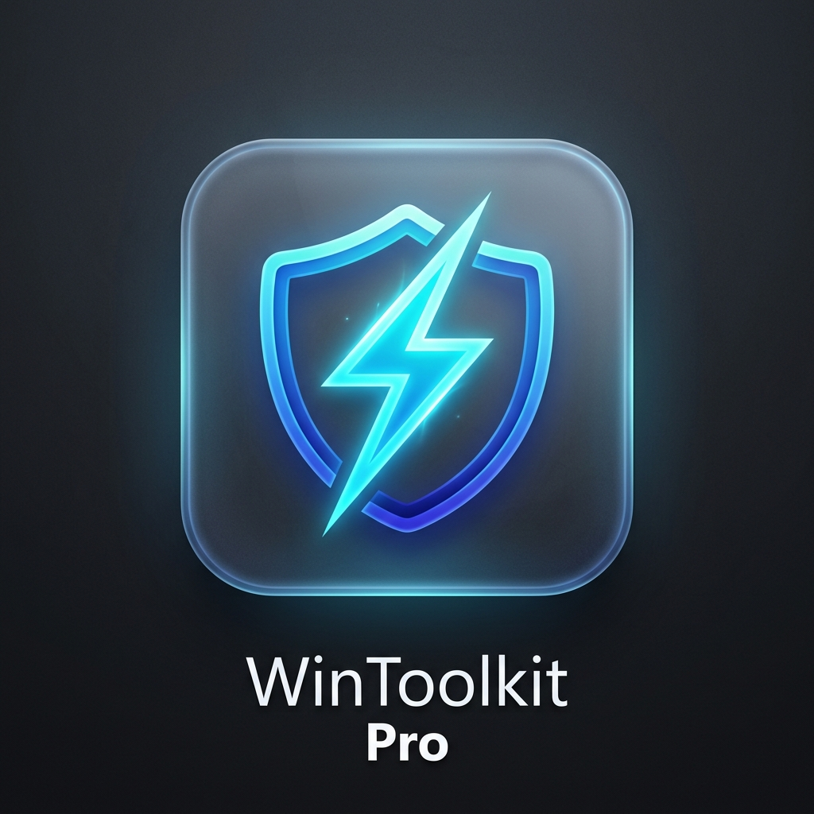

#  WinToolkit Pro

A modern, high-performance Windows 11 utility application built with **.NET 9** and **WPF-UI (Fluent Windows 11 Design)**. It combines unattended silent software installation, Windows Update certified driver scanning & installation, and OS debloating/optimizations.

[](https://github.com/ugendarraju/WinToolkitPro/releases/latest)
[](https://github.com/ugendarraju/WinToolkitPro)
[](https://github.com/ugendarraju/WinToolkitPro)

### 🚀 Direct Standalone Downloads (No Setup Required)
* **[⚡ Download WinToolkitPro.exe (Standalone Single File)](https://github.com/ugendarraju/WinToolkitPro/releases/latest/download/WinToolkitPro.exe)**
* **[📦 Download WinToolkitPro Standalone ZIP](https://github.com/ugendarraju/WinToolkitPro/releases/latest/download/WinToolkitPro-v1.4.6-standalone-win-x64.zip)**

---

## 🌟 Key Features

### 1. 📦 Unattended Silent Software Installer
* **Multi-Select Catalog:** Choose multiple applications across categories (Browsers, Developer Tools, Utilities, Media, Gaming, Communication, Runtimes).
* **Zero User Input Required:** Silently downloads and installs applications in the background using `winget` (`--silent --accept-package-agreements --accept-source-agreements`).
* **Real-time Queue & Progress:** Displays live download percentages, installation steps, and terminal logs.
* **Instant Filtering & Search:** Filter by category or search instantly by name, description, or package ID.

### 2. ⚡ OS Optimizer & Debloater (Winhance Style)
* **Automatic System Restore Point:** Automatically creates a Windows System Restore Point (`Checkpoint-Computer`) before applying tweaks for safety.
* **Privacy & Telemetry:**
  * Disable Windows Telemetry & Diagnostic Data Collection (`DiagTrack`).
  * Disable Bing Search & Web Suggestions in Start Menu.
  * Disable Advertising ID tracking.
  * Disable Activity History tracking.
* **Performance & Gaming:**
  * Unlock & activate the hidden **Ultimate Performance** power plan.
  * Disable Xbox Game Bar & DVR background video recording.
  * Enable Hardware-Accelerated GPU Scheduling (HAGS).
  * Optimize multimedia network throttling index for lower gaming ping.
* **Windows Debloat:**
  * Silently remove consumer bloatware & sponsored promotional apps (Candy Crush, TikTok, Disney, etc.).
  * Remove deprecated Cortana app, Feedback Hub, and Windows Tips.
* **UI & Usability Tweaks:**
  * Restore the classic Windows 10 right-click context menu on Windows 11.
  * Show known file extensions and hidden files in File Explorer.
* **One-Click Revert:** Revert any applied tweak back to Windows default settings.

### 3. 🚗 Hardware & Driver Manager
* **Hardware Inventory:** Scans local devices (Display, Network, Media/Audio, Bluetooth, Storage, System) and flags missing or error-state drivers.
* **Microsoft Certified Driver Search:** Queries the official Windows Update Catalog COM API (`Microsoft.Update.Session`) for certified driver updates matching your exact hardware IDs over direct HTTPS.
* **Direct Vendor Feeds:** Direct identification and support for OEM drivers (Intel, AMD, NVIDIA, Realtek).
* **Silent Driver Installation:** Downloads and installs driver updates directly from Microsoft's catalog without third-party ad software or torrents.

---

## 📁 How to Customize & Add New Software / Tweaks

The application is completely **data-driven**:

### Adding New Software
Open [Data/apps.json](file:///e:/Projects/utilities/Data/apps.json) and add an item:
```json
{
  "Id": "notepadplusplus",
  "Name": "Notepad++",
  "WingetId": "Notepad++.Notepad++",
  "Category": "Utilities",
  "Description": "Fast tabbed text editor.",
  "Icon": "DocumentText24"
}
```

### Adding New Optimizations
Open [Data/tweaks.json](file:///e:/Projects/utilities/Data/tweaks.json) and add an item:
```json
{
  "Id": "my_custom_tweak",
  "Title": "My Custom Optimization",
  "Category": "Performance",
  "Description": "What this tweak does.",
  "Impact": "Recommended",
  "ApplyScript": "Set-ItemProperty -Path '...' -Name '...' -Value 1",
  "RevertScript": "Set-ItemProperty -Path '...' -Name '...' -Value 0"
}
```

---

## 🚀 How to Run

### Option 1: Run the Precompiled Release Executable
Double-click or run:
```powershell
.\publish\WinToolkitPro.exe
```

### Option 2: Run via .NET CLI
```powershell
dotnet run
```

### Option 3: Run as Administrator
For features that modify system services, power schemes, or create Restore Points, launch the app as Administrator or click the **🛡️ Elevate to Admin** button in the app's top title bar.
